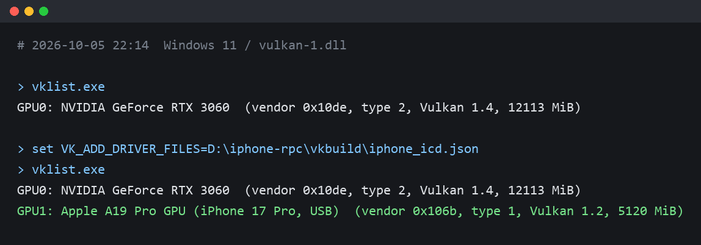
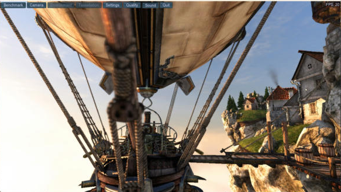
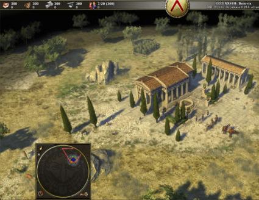

# PocketGPU

[English](README.md) | 日本語

README を読んでくれてありがとう。鶴田です。

この PocketGPU は、スマホのスペックは高いけどグラボが乗っていない PC を使っている人向けで、ケーブルで PC とスマホを繋げたら、GPU 処理をスマホが代わりに処理してくれるツールです。

Windows と Linux の Vulkan ドライバとして動きます。DirectX と OpenGL のアプリは DXVK・vkd3d・zink を通ります。スマホ側は iPhone と Android に対応しています。

[Claude Code](https://claude.com/claude-code) で作りました。コードのほとんどは Claude と一緒に書いています。

- テスター向けのセットアップと修理のスクリプト：[`setup`](setup)（[tsurutanmen/pocketgpu-setup](https://github.com/tsurutanmen/pocketgpu-setup) にも同じ物）
- Discord：https://discord.gg/F3Mk8DBxqQ
- ライセンス：Apache-2.0（`mc/pumpkin-ios` だけ GPL-3.0）

## スクリーンショット

iPhone が、PC の Vulkan の GPU の 1 つとして見えます。

| Unigine Heaven（DirectX 11、DXVK 経由） | 0 A.D.（Vulkan） |
| --- | --- |
|  |  |

## 試し方

1. [Releases](https://github.com/tsurutanmen/pocketgpu/releases) から `PocketGPU-*-windows.zip` を取ってきて、展開します。
2. iPhone なら `RpcServer-*.ipa` を自分の Apple ID で入れます（AltStore、Impactor、iloader、xtool のどれか）。Android なら `android/pocketgpu.apk` を入れます。
3. スマホを PC に挿して、`Setup-PocketGPU.cmd` をダブルクリックします。あとは、ゲームの `.exe` を `Run-on-iPhone-GPU.cmd` にドラッグします。

## 自分で入れる物

このリポジトリには入っていません。Apple、LunarG、Microsoft などが配っている物です。キットの `Setup-PocketGPU.cmd` が、入っているかを調べて、winget で入れるかを聞きます。

| 何のため | 入れる物 | 入手先 |
| --- | --- | --- |
| Windows で iPhone を使う | Apple の USB ドライバと Apple Mobile Device Service | Microsoft Store の [Apple Devices](https://apps.microsoft.com/detail/9np83lwlpz9k) か [iTunes](https://www.apple.com/itunes/) |
| Windows | Vulkan ローダー `vulkan-1.dll`（64 ビットと 32 ビット） | LunarG の [Vulkan Runtime](https://vulkan.lunarg.com/sdk/home) |
| Windows | Visual C++ ランタイム | [vc_redist.x64.exe](https://aka.ms/vs/17/release/vc_redist.x64.exe) |
| iPhone | 自分の Apple ID でアプリを入れる道具 | [AltStore](https://altstore.io)・[Impactor](https://github.com/khcrysalis/Impactor/releases)・[iloader](https://github.com/nab138/iloader/releases)・[xtool](https://github.com/xtool-org/xtool) のどれか |
| Android | adb | [Android platform-tools](https://developer.android.com/tools/releases/platform-tools) |
| Linux で iPhone を使う | usbmuxd | ディストリのパッケージ |

## 中身

| フォルダ | 中身 |
| --- | --- |
| `vk/icd` | PC の Vulkan ドライバ（ICD）。Vulkan の命令をスマホへ送る |
| `vk/remote` | スマホの GPU で命令を動かす受け手（`server.c`。Android 用にも組める） |
| `vk/tests` | Vulkan と DirectX 9〜12 の小さな試験プログラム |
| `vk/tools` | 測ったり、不具合を調べたりする道具 |
| `vk/third_party` | bcdec・lz4・stb_image |
| `Sources` | iPhone アプリ（PocketGPU）と、カメラだけのアプリ（PocketCam） |
| `android` | Android アプリ（Java）。`vk/remote` の受け手も中に入れる |
| `pc` | PC の道具：キットを組む道具、USB の中継、iPhone のログと状態を見る道具 |
| `pc/kit`, `pc/kit_linux` | Windows と Linux のキットに入れるスクリプト |
| `pc/app` | Windows アプリ `PocketGPU.exe`（C#、WPF） |
| `pc/cam` | Windows のカメラの受け手、仮想カメラ、その設定の道具 |
| `pc/audio` | Windows のマイクの受け手 |
| `pc/livecap` | 字幕 |
| `pc/linux_media` | Linux のカメラとマイクの受け手 |
| `pc/opengl` | OpenGL の追加パック。Mesa の zink で OpenGL のアプリを動かす |
| `win` | ゲームや見本をスマホの GPU で動かして試すスクリプト |
| `mc` | iPhone アプリの中で Pumpkin（マイクラのサーバー）を動かす部品（使うかは選べる） |
| `patches` | llama.cpp と whisper.cpp に当てる修正 |
| `ci`, `.github/workflows`, `codemagic.yaml` | 組み立てのスクリプト |
| `setup` | キットを入れる・直すスクリプトと、その試験。tsurutanmen/pocketgpu-setup と同じ物 |
| `server/kit-worker` | キットの配布、更新、テスターのログを受ける Cloudflare Worker |
| `server/discord` | Discord の bot と、キットを配る道具、更新を出す道具 |
| `docs` | 計画と試験のメモ（日本語） |
| `docs/kit` | テスター向けの入れ方、よくある質問、調べたメモ（日本語と英語） |

## 組み方

| 組む物 | コマンド | 要る物 |
| --- | --- | --- |
| Windows のドライバと道具 | `vk/build_win.sh <out>` | zig（`zig cc`）。Visual Studio は要らない |
| Linux のドライバ（WSL、Steam Deck も） | `vk/build_linux.sh <out>` | gcc と Vulkan のヘッダー |
| Android の受け手 | `vk/build_android.sh <out>` | Android NDK。Android Studio は要らない |
| Android アプリ（`.apk`） | `android/build_apk.sh` | Android SDK の build-tools 35 と platform 34、JDK 17。Gradle は要らない。`PGPU_SERVER_DIR` に上で組んだ受け手の場所を入れる |
| iPhone アプリ（署名の無い `.ipa`） | `ci/build_ios.sh` | macOS と Xcode 26.3。Codemagic か `ios.yml` のワークフローで動く |
| Windows アプリ | `pc/app/build.cmd` | Windows に入っている C# のコンパイラ（.NET Framework 4.8） |
| Windows のカメラ、マイク、字幕 | `pc/cam/build.sh`, `pc/audio/build.sh`, `pc/livecap/build.sh` | zig |
| iPhone アプリ用の Pumpkin | `ci/build_pumpkin_ios.sh` | Rust。`MINECRAFT=true` のときだけ |
| テスター 1 人分の Windows キット | `python pc/make_kit.py <name>` | 上で組んだドライバとアプリ。`PGKIT_UPDATE_URL` に自分の更新サーバーを入れる |
| Linux のキット | `python pc/make_linux_kit.py <name>` | zig。Linux のカメラとマイクの受け手も組む |
| 更新サーバー | `server/kit-worker` で `npx wrangler deploy` | Cloudflare のアカウント。`wrangler.toml` の `YOUR-...` を自分の値にする |

## テスター

- Toasty~ (`bl7ck_ic3`)
- BerBP (`berbp_but_now_its_benny`)
- Brewmasters (`brewmaegger_s2`)
- Josetruco1425 (`josetruco1425`)
- PabloC557 (`remythemice557`)
- ぴとん345 (`piton345`)
- Aurora (`tranzide`)
- 시유 (`seeu0001`)
- StarBite (`iwannabitestars`)
- Hi (`balzer0699`)

## ライセンス

| 部分 | ライセンス |
| --- | --- |
| 下の行以外の全部 | Apache-2.0（`LICENSE`） |
| `setup` | MIT（`setup/LICENSE`） |
| `mc/pumpkin-ios` | GPL-3.0（`mc/pumpkin-ios/LICENSE`）。`MINECRAFT=true` で組んだ iPhone アプリは Pumpkin を含むので、全体が GPL-3.0 になる |
| `vk/third_party/bcdec` | MIT か Unlicense |
| `vk/third_party/lz4` | BSD-2-Clause |
| `vk/third_party/stb` | MIT かパブリックドメイン |

このリポジトリに入っておらず、組むときに取ってくる物：MoltenVK（Apache-2.0）、llama.cpp（MIT）、whisper.cpp（MIT）、DXVK（zlib。キットは dxvk-macOS の async 1.10.3 を使う）、vkd3d-proton 3.0.1（LGPL-2.1。DirectX 12 の試験用）、mesa-dist-win の Mesa 26.2.4（MIT。`pc/opengl` 用）、Pumpkin（GPL-3.0）。
